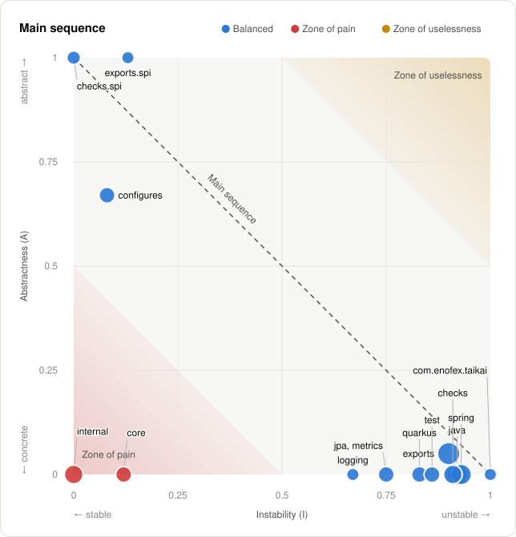
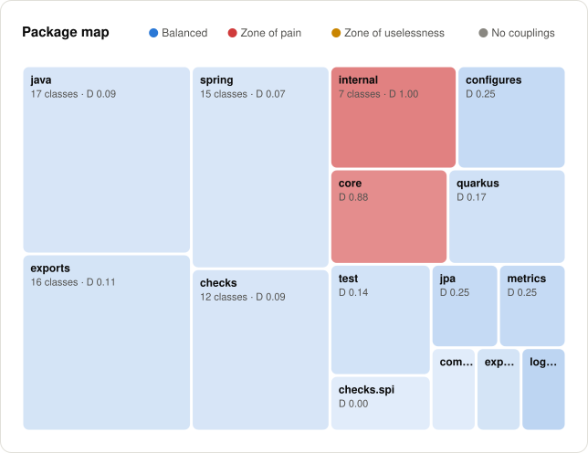
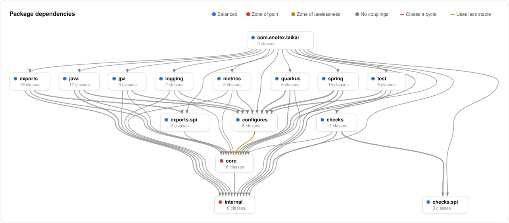
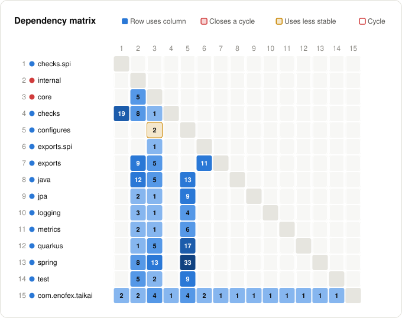
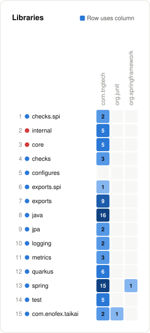

# Architecture Metrics

The metrics of `com.enofex.taikai`, measured by Taikai. Every package counts on its own, without its subpackages. Packages and coupling count top-level classes, each together with the classes nested in it, while inheritance and cohesion count every class on its own. Only dependencies between the measured classes count, except for the libraries the packages use, and never those on the JDK. Packages and classes are named relative to `com.enofex.taikai`. The lists show at most 20 classes each.

**Contents:** [Summary](#summary) · [Main Sequence](#main-sequence) · [Package Map](#package-map) · [Packages](#packages) · [Package Dependencies](#package-dependencies) · [Libraries](#libraries) · [Inheritance](#inheritance) · [Coupling](#coupling) · [Cohesion](#cohesion)

## Summary

| Metric | Value |
| --- | ---: |
| Packages | 15 |
| Classes | 112 |
| Abstract classes and interfaces | 10 |
| Average distance from the main sequence | 0.25 |
| Packages in the zone of pain | 2 |
| Packages in the zone of uselessness | 0 |
| Package cycles | 0 |
| Dependencies on less stable packages | 1 |
| Libraries | 3 |
| Maximum inheritance depth | 1 |

## Main Sequence

Each dot is a package, sized by its number of classes. The abstractness A is the share of abstract classes and interfaces. The instability I = Ce / (Ca + Ce) is the share of outgoing couplings: Ca counts the classes in other packages that depend on the package, Ce the classes of the package that depend on other packages. A dot without room for its name has none: the packages are all listed below.

| Value | Meaning |
| --- | --- |
| A = 0 | Only concrete classes |
| A = 1 | Only abstract classes and interfaces |
| I = 0 | Stable: other packages depend on it and it depends on none, so a change affects many classes |
| I = 1 | Unstable: it depends on other packages and none depends on it, so it is easy to change |
| D = 0 | On the main sequence, the best |
| D = 1 | In a corner, as far from the main sequence as possible, the worst |

A stable package should be abstract, so that it can be extended without being changed, and an unstable package concrete. Packages on the main sequence A + I = 1 balance both, and the distance D = |A + I - 1| shows how far a package is from it. With a distance above 0.50, a concrete and stable package is in the zone of pain, hard to change as many classes depend on it, and an abstract and unstable package in the zone of uselessness, with abstractions that barely anything uses. Packages without couplings to other packages have no instability and are not shown.

## Package Map

Each tile is a package: its area is its number of classes and its color its zone, the stronger the farther the package is from the main sequence.

## Packages

| Package | Classes | Abstract | Ca | Ce | I | A | D | Visibility | Libraries | Zone |
| --- | ---: | ---: | ---: | ---: | ---: | ---: | ---: | ---: | ---: | --- |
| [`com.enofex.taikai`](taikai-core/src/main/java/com/enofex/taikai) | 2 | 0 | 0 | 2 | 1.00 | 0.00 | 0.00 | 0.50 | 2 |  |
| [`checks`](taikai-core/src/main/java/com/enofex/taikai/checks) | 11 | 0 | 1 | 10 | 0.91 | 0.00 | 0.09 | 0.73 | 1 |  |
| [`checks.spi`](taikai-core/src/main/java/com/enofex/taikai/checks/spi) | 3 | 3 | 11 | 0 | 0.00 | 1.00 | 0.00 | 1.00 | 1 |  |
| [`configures`](taikai-core/src/main/java/com/enofex/taikai/configures) | 6 | 4 | 22 | 2 | 0.08 | 0.67 | 0.25 | 1.00 | 0 |  |
| [`core`](taikai-core/src/main/java/com/enofex/taikai/core) | 6 | 0 | 30 | 4 | 0.12 | 0.00 | 0.88 | 1.00 | 1 | pain |
| [`exports`](taikai-core/src/main/java/com/enofex/taikai/exports) | 19 | 1 | 1 | 9 | 0.90 | 0.05 | 0.05 | 0.26 | 1 |  |
| [`exports.spi`](taikai-core/src/main/java/com/enofex/taikai/exports/spi) | 2 | 2 | 7 | 1 | 0.13 | 1.00 | 0.13 | 1.00 | 1 |  |
| [`internal`](taikai-core/src/main/java/com/enofex/taikai/internal) | 11 | 0 | 48 | 0 | 0.00 | 0.00 | 1.00 | 1.00 | 1 | pain |
| [`java`](taikai-core/src/main/java/com/enofex/taikai/java) | 17 | 0 | 1 | 11 | 0.92 | 0.00 | 0.08 | 0.29 | 1 |  |
| [`jpa`](taikai-core/src/main/java/com/enofex/taikai/jpa) | 3 | 0 | 1 | 3 | 0.75 | 0.00 | 0.25 | 0.67 | 1 |  |
| [`logging`](taikai-core/src/main/java/com/enofex/taikai/logging) | 2 | 0 | 1 | 2 | 0.67 | 0.00 | 0.33 | 0.50 | 1 |  |
| [`metrics`](taikai-core/src/main/java/com/enofex/taikai/metrics) | 3 | 0 | 1 | 3 | 0.75 | 0.00 | 0.25 | 0.33 | 1 |  |
| [`quarkus`](taikai-core/src/main/java/com/enofex/taikai/quarkus) | 6 | 0 | 1 | 5 | 0.83 | 0.00 | 0.17 | 0.67 | 1 |  |
| [`spring`](taikai-core/src/main/java/com/enofex/taikai/spring) | 15 | 0 | 1 | 13 | 0.93 | 0.00 | 0.07 | 0.53 | 2 |  |
| [`test`](taikai-core/src/main/java/com/enofex/taikai/test) | 6 | 0 | 1 | 6 | 0.86 | 0.00 | 0.14 | 0.33 | 1 |  |

Visibility is the relative visibility of Herbert Dowalil, the share of public classes, and Libraries the number of libraries that the package uses.

## Package Dependencies

A package is drawn above the packages it depends on, so that the packages that many depend on are at the bottom, and is marked in the color of its zone. An arrow points from a package to a package it depends on, and the thicker it is, the more classes of the one depend on classes of the other. Red arrows point upwards and close a cycle: without them, the packages would have no cycles. Orange arrows point to a less stable package.

### Dependency Matrix

A row counts the pairs of classes with which its package depends on the package of each column, numbered as the rows. The packages are ordered from the bottom of the chart up, so that a package depends on the packages above it: the red cells above the diagonal close a cycle, as the red arrows do, a red frame surrounds the packages of a cycle, and the orange cells use a less stable package, as the orange arrows do.

### Package Cycles

None.

### Dependencies on Less Stable Packages

A package should only depend on packages that are at least as stable as itself, as the stable dependencies principle of Robert C. Martin demands: a package that many classes depend on is hard to change, so it should not depend on a package that changes more easily. These dependencies point to a package with a higher instability I, the largest increase first. They are orange in the chart and the matrix, unless they close a cycle.

| Package | Depends on | Instability | Dependencies |
| --- | --- | --- | ---: |
| [`configures`](taikai-core/src/main/java/com/enofex/taikai/configures) | [`core`](taikai-core/src/main/java/com/enofex/taikai/core) | 0.08 → 0.12 | 2 |

## Libraries

A row is a package, numbered as in the dependency matrix, and a column a library, named after the first two segments of the packages of its classes, such as `org.springframework` or `jakarta.persistence`. A cell counts the classes of the package that use the library. The JDK does not count, nor do the standard libraries of Kotlin, Groovy and Scala for the classes written in them, nor the classes of the project: those in the measured packages and in the package of at least two segments that they share.

| Library | Packages | Classes |
| --- | ---: | ---: |
| `com.tngtech` | 14 | 79 |
| `org.junit` | 1 | 1 |
| `org.springframework` | 1 | 1 |

### Packages Without Libraries

[`configures`](taikai-core/src/main/java/com/enofex/taikai/configures)

## Inheritance

The inheritance depth of a class counts its superclasses, its subclasses only the direct ones. Interfaces and anonymous classes do not count.

### Deepest Classes

| Class | Depth |
| --- | ---: |
| [`java.ImportsConfigurer`](taikai-core/src/main/java/com/enofex/taikai/java/ImportsConfigurer.java) | 1 |
| [`java.JavaConfigurer`](taikai-core/src/main/java/com/enofex/taikai/java/JavaConfigurer.java) | 1 |
| [`java.NamingConfigurer`](taikai-core/src/main/java/com/enofex/taikai/java/NamingConfigurer.java) | 1 |
| [`jpa.EntitiesConfigurer`](taikai-core/src/main/java/com/enofex/taikai/jpa/EntitiesConfigurer.java) | 1 |
| [`jpa.JpaConfigurer`](taikai-core/src/main/java/com/enofex/taikai/jpa/JpaConfigurer.java) | 1 |
| [`logging.LoggingConfigurer`](taikai-core/src/main/java/com/enofex/taikai/logging/LoggingConfigurer.java) | 1 |
| [`metrics.MetricsConfigurer`](taikai-core/src/main/java/com/enofex/taikai/metrics/MetricsConfigurer.java) | 1 |
| [`quarkus.AiConfigurer`](taikai-core/src/main/java/com/enofex/taikai/quarkus/AiConfigurer.java) | 1 |
| [`quarkus.PanacheConfigurer`](taikai-core/src/main/java/com/enofex/taikai/quarkus/PanacheConfigurer.java) | 1 |
| [`quarkus.QuarkusConfigurer`](taikai-core/src/main/java/com/enofex/taikai/quarkus/QuarkusConfigurer.java) | 1 |
| [`quarkus.ResourcesConfigurer`](taikai-core/src/main/java/com/enofex/taikai/quarkus/ResourcesConfigurer.java) | 1 |
| [`spring.BootConfigurer`](taikai-core/src/main/java/com/enofex/taikai/spring/BootConfigurer.java) | 1 |
| [`spring.ConfigurationsConfigurer`](taikai-core/src/main/java/com/enofex/taikai/spring/ConfigurationsConfigurer.java) | 1 |
| [`spring.ControllersConfigurer`](taikai-core/src/main/java/com/enofex/taikai/spring/ControllersConfigurer.java) | 1 |
| [`spring.PropertiesConfigurer`](taikai-core/src/main/java/com/enofex/taikai/spring/PropertiesConfigurer.java) | 1 |
| [`spring.RepositoriesConfigurer`](taikai-core/src/main/java/com/enofex/taikai/spring/RepositoriesConfigurer.java) | 1 |
| [`spring.ServicesConfigurer`](taikai-core/src/main/java/com/enofex/taikai/spring/ServicesConfigurer.java) | 1 |
| [`spring.SpringConfigurer`](taikai-core/src/main/java/com/enofex/taikai/spring/SpringConfigurer.java) | 1 |
| [`spring.TransactionalConfigurer`](taikai-core/src/main/java/com/enofex/taikai/spring/TransactionalConfigurer.java) | 1 |
| [`test.JUnitConfigurer`](taikai-core/src/main/java/com/enofex/taikai/test/JUnitConfigurer.java) | 1 |

### Most Extended Classes

| Class | Subclasses |
| --- | ---: |
| [`configures.AbstractConfigurer`](taikai-core/src/main/java/com/enofex/taikai/configures/AbstractConfigurer.java) | 21 |

## Coupling

The fan-in of a class counts the classes that depend on it, its fan-out the classes it depends on.

### Most Used Classes

| Class | Fan-in |
| --- | ---: |
| [`core.TaikaiRule`](taikai-core/src/main/java/com/enofex/taikai/core/TaikaiRule.java) | 28 |
| [`configures.Configurer`](taikai-core/src/main/java/com/enofex/taikai/configures/Configurer.java) | 26 |
| [`configures.ConfigurerContext`](taikai-core/src/main/java/com/enofex/taikai/configures/ConfigurerContext.java) | 23 |
| [`configures.AbstractConfigurer`](taikai-core/src/main/java/com/enofex/taikai/configures/AbstractConfigurer.java) | 21 |
| [`configures.DisableableConfigurer`](taikai-core/src/main/java/com/enofex/taikai/configures/DisableableConfigurer.java) | 21 |
| [`internal.Modifiers`](taikai-core/src/main/java/com/enofex/taikai/internal/Modifiers.java) | 19 |
| [`checks.spi.CheckContext`](taikai-core/src/main/java/com/enofex/taikai/checks/spi/CheckContext.java) | 13 |
| [`checks.spi.TaikaiCheck`](taikai-core/src/main/java/com/enofex/taikai/checks/spi/TaikaiCheck.java) | 12 |
| [`exports.ArchitectureMetrics`](taikai-core/src/main/java/com/enofex/taikai/exports/ArchitectureMetrics.java) | 9 |
| [`spring.SpringDescribedPredicates`](taikai-core/src/main/java/com/enofex/taikai/spring/SpringDescribedPredicates.java) | 9 |
| [`configures.Customizer`](taikai-core/src/main/java/com/enofex/taikai/configures/Customizer.java) | 8 |
| [`exports.spi.ExportContext`](taikai-core/src/main/java/com/enofex/taikai/exports/spi/ExportContext.java) | 8 |
| [`internal.Arguments`](taikai-core/src/main/java/com/enofex/taikai/internal/Arguments.java) | 8 |
| [`internal.Classes`](taikai-core/src/main/java/com/enofex/taikai/internal/Classes.java) | 8 |
| [`internal.DescribedPredicates`](taikai-core/src/main/java/com/enofex/taikai/internal/DescribedPredicates.java) | 8 |
| [`exports.spi.TaikaiExport`](taikai-core/src/main/java/com/enofex/taikai/exports/spi/TaikaiExport.java) | 7 |
| [`core.ClassCriteria`](taikai-core/src/main/java/com/enofex/taikai/core/ClassCriteria.java) | 6 |
| [`core.TaikaiException`](taikai-core/src/main/java/com/enofex/taikai/core/TaikaiException.java) | 6 |
| [`internal.ArchConditions`](taikai-core/src/main/java/com/enofex/taikai/internal/ArchConditions.java) | 6 |
| [`exports.Svg`](taikai-core/src/main/java/com/enofex/taikai/exports/Svg.java) | 5 |

### Classes with the Most Dependencies

| Class | Fan-out |
| --- | ---: |
| [`Taikai`](taikai-core/src/main/java/com/enofex/taikai/Taikai.java) | 20 |
| [`java.JavaConfigurer`](taikai-core/src/main/java/com/enofex/taikai/java/JavaConfigurer.java) | 19 |
| [`spring.SpringConfigurer`](taikai-core/src/main/java/com/enofex/taikai/spring/SpringConfigurer.java) | 16 |
| [`exports.MetricsMarkdownExport`](taikai-core/src/main/java/com/enofex/taikai/exports/MetricsMarkdownExport.java) | 12 |
| [`test.JUnitConfigurer`](taikai-core/src/main/java/com/enofex/taikai/test/JUnitConfigurer.java) | 11 |
| [`java.NamingConfigurer`](taikai-core/src/main/java/com/enofex/taikai/java/NamingConfigurer.java) | 10 |
| [`quarkus.QuarkusConfigurer`](taikai-core/src/main/java/com/enofex/taikai/quarkus/QuarkusConfigurer.java) | 10 |
| [`spring.ControllersConfigurer`](taikai-core/src/main/java/com/enofex/taikai/spring/ControllersConfigurer.java) | 10 |
| [`metrics.MetricsConfigurer`](taikai-core/src/main/java/com/enofex/taikai/metrics/MetricsConfigurer.java) | 9 |
| [`spring.TransactionalConfigurer`](taikai-core/src/main/java/com/enofex/taikai/spring/TransactionalConfigurer.java) | 9 |
| [`logging.LoggingConfigurer`](taikai-core/src/main/java/com/enofex/taikai/logging/LoggingConfigurer.java) | 8 |
| [`spring.BootConfigurer`](taikai-core/src/main/java/com/enofex/taikai/spring/BootConfigurer.java) | 8 |
| [`java.ImportsConfigurer`](taikai-core/src/main/java/com/enofex/taikai/java/ImportsConfigurer.java) | 7 |
| [`jpa.EntitiesConfigurer`](taikai-core/src/main/java/com/enofex/taikai/jpa/EntitiesConfigurer.java) | 7 |
| [`quarkus.AiConfigurer`](taikai-core/src/main/java/com/enofex/taikai/quarkus/AiConfigurer.java) | 7 |
| [`quarkus.ResourcesConfigurer`](taikai-core/src/main/java/com/enofex/taikai/quarkus/ResourcesConfigurer.java) | 7 |
| [`spring.PropertiesConfigurer`](taikai-core/src/main/java/com/enofex/taikai/spring/PropertiesConfigurer.java) | 7 |
| [`spring.RepositoriesConfigurer`](taikai-core/src/main/java/com/enofex/taikai/spring/RepositoriesConfigurer.java) | 7 |
| [`spring.ServicesConfigurer`](taikai-core/src/main/java/com/enofex/taikai/spring/ServicesConfigurer.java) | 7 |
| [`exports.ArchitectureMetrics`](taikai-core/src/main/java/com/enofex/taikai/exports/ArchitectureMetrics.java) | 6 |

## Cohesion

The LCOM4 of a class counts the groups of its methods that have nothing in common: methods belong together if they use the same field or method of their object, also an inherited one, or call each other. Lower is better: 1 is best, as all methods work together. A higher value means that the class does as many unrelated things and can be split into as many classes. Constructors, static and abstract methods, getters and setters do not count, nor do methods without a connection to another member of their class. Interfaces, records and anonymous classes are not measured.

### Least Cohesive Classes

| Class | LCOM4 | Methods |
| --- | ---: | ---: |
| [`Taikai$Builder`](taikai-core/src/main/java/com/enofex/taikai/Taikai.java) | 8 | 22 |
| [`exports.PerExportContext`](taikai-core/src/main/java/com/enofex/taikai/exports/PerExportContext.java) | 3 | 3 |
| [`java.JavaConfigurer`](taikai-core/src/main/java/com/enofex/taikai/java/JavaConfigurer.java) | 2 | 130 |
| [`metrics.MetricsConfigurer`](taikai-core/src/main/java/com/enofex/taikai/metrics/MetricsConfigurer.java) | 2 | 26 |
| [`spring.SpringConfigurer`](taikai-core/src/main/java/com/enofex/taikai/spring/SpringConfigurer.java) | 2 | 15 |
| [`Taikai`](taikai-core/src/main/java/com/enofex/taikai/Taikai.java) | 2 | 11 |
| [`exports.DependencyMatrix$Grid`](taikai-core/src/main/java/com/enofex/taikai/exports/DependencyMatrix.java) | 2 | 10 |
| [`quarkus.QuarkusConfigurer`](taikai-core/src/main/java/com/enofex/taikai/quarkus/QuarkusConfigurer.java) | 2 | 5 |
| [`configures.AbstractConfigurer`](taikai-core/src/main/java/com/enofex/taikai/configures/AbstractConfigurer.java) | 2 | 3 |
| [`checks.PerCheckContext`](taikai-core/src/main/java/com/enofex/taikai/checks/PerCheckContext.java) | 2 | 2 |
